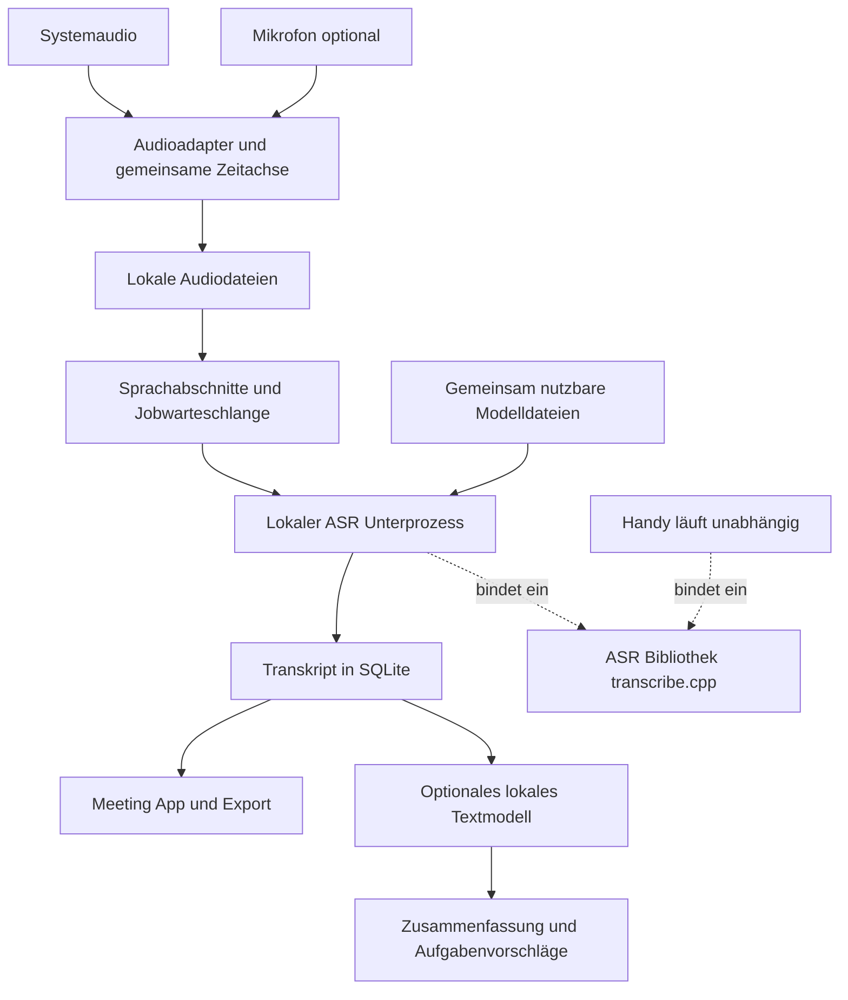

# Masterplan für eine lokale Meeting App im Handy Ökosystem

**Empfehlung:** HandyMeeting nimmt Meeting-Audio eigenständig lokal auf, schreibt während des Meetings mit und verwendet Spracherkennungsbibliotheken und installierte Modelle aus dem Handy-Ökosystem. Die Nachbearbeitung ergänzt Zusammenfassung, Entscheidungen und To-dos mit Originalbelegen. Lokal ist der Standard; eine ausdrücklich gewählte Cloud-Option verarbeitet ausschließlich Text.

Damit bleiben Meeting-Oberfläche, Sitzungen und Aufzeichnung unabhängig von Handy. Spracherkennung und Modellunterstützung kommen aus dessen Ökosystem. Ein zusätzlicher Dienst in Handy ist eine spätere Optimierung, keine Voraussetzung.

**Produktname:** HandyMeeting ist eine eigenständige Companion App. Die öffentliche Beschreibung kennzeichnet sie ausdrücklich als unabhängig und nicht als offizielle Handy-Veröffentlichung; eine Zustimmung oder technische Schnittstellenzusage des Handy-Teams wird nicht behauptet.

**Stand:** 26. Oktober 2026. Rust/Tauri 1.0.0 mit lokalem Streaming, Historie, Wiederherstellung und belegter Nachbearbeitung wird für die Veröffentlichung vorbereitet. Die folgenden Produktziele und Freigabekriterien gelten weiterhin; Leistungswerte werden auf benannter Hardware geprüft.

**Aktuelle technische Entscheidung:** Die Anwendung verwendet Rust/Tauri und orientiert sich an Handy. Modelllisten stammen aus Handy, die Erkennung aus den offiziellen transcribe.cpp-Rust-Bindings; eine eigene Erkennungsengine oder ein zweiter Modellkatalog wird nicht entwickelt. Windows, Linux und beide Mac-Architekturen haben eigene Aufnahmeadapter und Pakete. Revisionierte Vorlagen, lokale Modellerkennung, optionale native Schlüsselspeicher und das private Agentenprotokoll mit sichtbarer Einzelfreigabe sind in Rust umgesetzt. Das Protokoll ist keine MCP-Schnittstelle. [Migrationsplan und Freigabestufen](docs/RUST_MIGRATION.md), [Veröffentlichung](docs/RELEASING.md). WPF-/Avalonia-Prototypen und Nutzeraufnahmen bleiben erhalten. Tatsächliche Build-Ergebnisse und offene Geräte-/Langzeitprüfungen stehen getrennt im [Prüfbericht](TEST_REPORT.md) und [Plattformstatus](PORTABILITY.md).

# Vier Produktziele und ihre Freigabekriterien

HandyMeeting soll aus einem Meeting eine lokal gesicherte, nachvollziehbare Arbeitsgrundlage machen. Der Produktvorteil liegt im zusammenhängenden Ablauf: aufnehmen, währenddessen prüfen, Unterbrechungen überstehen und belegte Ergebnisse verwenden. Technische Gemeinsamkeiten mit OBS und anderen offenen Werkzeugen werden anerkannt; Überlegenheit muss an denselben Aufnahmen und Messbedingungen gezeigt werden.

## Während des Meetings die Qualität erkennen

Teilnehmende sollen früh sehen, ob beide gewünschten Seiten ankommen und sinnvoll erkannt werden. Dafür werden Pegel, Erkennungsrückstand und der dauerhaft geschriebene Stand je Spur getrennt dargestellt. Eine ausgefallene Quelle darf nicht durch den Fortschritt der anderen gesund erscheinen.

Der Windows-Prototyp hat getrennte Spuren und Live-Text. Als nächste Schritte folgen genaue Geräteereignisse, ein überprüfbarer Stand je Spur und eine Warnung bei länger ausbleibendem brauchbarem Text. Personen werden aus einer Audiospur nicht ohne Nachweis identifiziert.

Zielwerte auf benannter Referenzhardware: nach dem Modellladen eine Vorschau innerhalb von drei Sekunden bei mindestens 95 Prozent der markierten Sprachabschnitte; insgesamt unter 0,7 Sekunden Erkennungsrechenzeit je Sekunde Meeting bei zwei Spuren. Der gesamte Arbeitsspeicher, Private Bytes und gegebenenfalls Grafikspeicher werden getrennt erfasst. Ein Modellwechsel darf die Aufnahme nicht blockieren. Qualität an Abschnittsgrenzen wird mit absichtlich über die Grenze gesprochenen Wörtern und Sätzen geprüft.

## Unterbrechungen ohne Verlust bestätigter Daten überstehen

Audio und Text erhalten eigene dauerhafte Schreibpunkte. Ein bestätigter Schreibpunkt muss nach einem Prozessabbruch bytegleich beziehungsweise hashgleich wiederherstellbar sein. Noch nicht bestätigte Endstücke werden messbar ausgewiesen und nicht als gesichert dargestellt.

Der Prototyp isoliert die Erkennung, schreibt kurze Audiodateien und führt ein Textjournal. Die Nachbearbeitung speichert zusätzlich jeden geprüften Abschnitt, sodass ein Neustart bereits bestätigte KI-Anfragen nicht erneut ausführt.

Freigabe erfordert Abbrüche der Erkennung, des Aufnahmeprozesses und der Nachbearbeitung sowie Tests für abgerissene Metadaten, beschädigte Antworten, volle Datenträger und blockierte Geräte. Ein realer Zweistundenlauf mit zwei Quellen ist ein eigener Nachweis; erzeugte Audiodateien oder eine beschleunigte Verarbeitung ersetzen ihn nicht. Ein Prozessabbruch belegt keinen Schutz gegen Stromausfall oder Hardwaredefekt. Der Testwächter wird ebenfalls auf Dateisperren und gleichzeitige Statuswechsel geprüft.

## Den gesamten Meetingablauf einfach bedienbar machen

Eine Sitzung verbindet Aufnahme, Transkript, Auswertungsfassungen und Originalstellen. Nutzer müssen keine Dateien zwischen mehreren Programmen verschieben oder eine eigene Warteschlange pflegen.

Der Prototyp besitzt Historie, Exporte und Wiederaufnahme. Die nächste Ausbaustufe ergänzt Suche, direkte Audiowiedergabe zur Textstelle und verständliche Aufnahmebereitschaft. Ein kurzer Nutzertest soll zeigen, ob eine erstmals verwendete Audioquelle innerhalb einer Minute richtig ausgewählt und kontrolliert werden kann. Zeitangaben bleiben ehrlich als Abschnittszeiten gekennzeichnet, solange keine geprüften Wortzeiten vorliegen.

Audioaufbewahrung wird ausdrücklich konfiguriert. Aktive, unvollständig erkannte und fehlerhafte Sitzungen sind vor automatischer Bereinigung geschützt. Eine Löschvorschau nennt die betroffenen Dateien und deren Umfang. Das Entfernen von Audio löscht weder das Transkript noch seine Auswertungsfassungen. Automatische Zusammenfassungen bleiben von automatisch ausgeführten Aufgaben getrennt.

## Ergebnisse mit überprüfbaren Originalbelegen liefern

Zusammenfassung, Entscheidungen und To-dos erhalten Quellenkennungen und wörtliche Zitate. Ein Klick öffnet die zugehörige Originalstelle. Jeder Lauf speichert seinen Transkriptstand, dessen Prüfsumme, Modell, Promptversion und Verarbeitungsweg. Eine neue Auswertung ersetzt keine frühere Fassung.

Die technische Freigabe verlangt gültige Quellen und vorhandene Originalzitate für jeden ausgegebenen Punkt. Zuständigkeit und Termin bleiben leer, wenn sie nicht belegt sind; relative Termine behalten ihren Wortlaut und werden zusammen mit dem Meetingdatum angezeigt. Entscheidungen müssen von Vorschlägen, Ablehnungen und noch offenen Fragen unterscheidbar sein.

Zusätzlich zur technischen Prüfung wird ein manuell bewerteter deutscher und englischer Referenzbestand aufgebaut. Er enthält Negationen, verworfene Vorschläge, undeutliche Zuständigkeiten, mehrere Sprecher und Gespräche mit Überlappungen. Ziel für ausdrücklich zugewiesene Aufgaben und Entscheidungen ist mindestens 95 Prozent Präzision auf diesem festgehaltenen Bestand; Vollständigkeit und Fehler werden daneben separat veröffentlicht. Ein vorhandenes Zitat beweist noch nicht die richtige Deutung.

Die Nachbearbeitung startet lokal. Cloud-Verarbeitung verlangt je Auswertung eine ausdrückliche Textfreigabe und erhält ausschließlich Text und Belegkennungen. Audio und lokale Dateipfade gehören nicht zum Anfrageformat. Weiterleitungen und ein stiller Wechsel von lokal zu Cloud sind gesperrt. API-Schlüssel werden unter Windows kontogebunden verschlüsselt gespeichert. Ein separat eingerichteter lokaler KI-Dienst muss selbst ebenfalls ohne Cloud-Weiterleitung betrieben werden.

# Zusammenarbeit mit Handy

HandyMeeting bleibt eine eigenständige Companion App und verwendet vorhandene Spracherkennungsbibliotheken und installierte Modellgewichte. Das Textmodell für Zusammenfassungen ist ein zusätzlicher Modelltyp; ein Sprachmodell zur Audioerkennung übernimmt diese Aufgabe nicht automatisch.

Die aktuelle gemeinsame Basis spart Implementierungsaufwand und doppelte Modelldateien. Eine gemeinsame geladene Modellinstanz wird dadurch nicht behauptet. Als nächste Integrationsstufe wird ein kleines versioniertes Fähigkeitsprotokoll mit Handy vorbereitet: verfügbare Modelle, unterstützte Sprachen, Streaming und Fehlerzustände. Private Handy-Einstellungen und API-Schlüssel werden nicht ohne einen ausdrücklich vorgesehenen Importmechanismus übernommen. Vor einer offiziellen Integration werden Umfang, Markenverwendung und die Wartung gemeinsamer Schnittstellen mit dem Maintainer abgestimmt.

# Freigabeprozess für ein verlässliches Open Source Projekt

Die Freigabe stützt sich auf wiederholbare Nachweise. Compilerwarnungen gelten als Fehler; Abhängigkeiten und native Laufzeiten sind versioniert. Der lokale Prüfablauf deckt Audiosicherung, Quellenvalidierung, Datenschutzgrenzen, Wiederaufnahme und den Testwächter ab. Ein Windows-Workflow für ein später veröffentlichtes Repository führt die unabhängigen Prüfungen ohne private Aufnahmen, Cloud-Zugangsdaten oder große Modellgewichte aus.

Änderungen am Aufnahme- oder Erkennungskern benötigen zusätzliche passende Hardware- und Langzeitprüfungen. Änderungen an Prompts oder Textanbietern benötigen lokale Modelltests einschließlich unverbindlicher Vorschläge und abgelehnter Aufgaben. Fehler mit Datenverlust, unbeabsichtigter Datenweitergabe, falsch zugeordneten Quellen oder unbemerktem Aufnahmeausfall blockieren eine stabile Veröffentlichung. Neue Fehler erhalten vor dem Fix einen reproduzierbaren Test.

Vergleiche mit OBS verwenden dieselbe Hardware, dieselben Quellen und festgehaltene Modelle. Gemessen werden Erkennungsqualität, Zeit bis zum ersten und letzten Text, Einrichtungsschritte, Speicher, Energiebedarf und die Wiederherstellung nach identischen Abbrüchen. Das schnellere Gesamttranskript eines anderen Systems ist ein Ergebnis, das offen berichtet wird.

Die Reihenfolge ist: belegte Nachbearbeitung und Wiederaufnahme, danach verlässliche Quellenkontrolle und Audiowiedergabe, anschließend Aufbewahrung und Suche, danach geprüfte Plattformadapter für macOS und Linux. Gemeinsame Bausteine, verständliche Fehlerzustände, dokumentierte Dateiformate und reproduzierbare Fehlerberichte bilden den Qualitätsstandard. Die aktuelle Windows-Oberfläche ist kein Nachweis für funktionierende macOS- oder Linux-Aufnahme.

# Was die Aussage des Maintainers bedeutet

In [Discussion 1923](https://github.com/cjpais/Handy/discussions/1923) schreibt cjpais: “This will not be added to Handy. It might be done in a companion app but not here”.

Das grenzt den Produktumfang ab: Meeting-Aufnahme und Meeting-Verwaltung sollen außerhalb der Handy-App entstehen. Die Aussage definiert weder eine Plugin-Schnittstelle noch eine gemeinsame Modellverwaltung oder einen Hintergrunddienst. Daraus folgt für diesen Entwurf: eigenes Repository, eigener Installer und eigene Oberfläche; Zusammenarbeit über vorhandene Bibliotheken und ausdrücklich vereinbarte Schnittstellen.

Ein Meeting-Tab im Handy-Fork wäre technisch möglich, würde aber dessen Produktentscheidung und jede zukünftige Aktualisierung zum dauerhaften Wartungsproblem machen. Die Companion App erhält deshalb ihren eigenen Lebenszyklus.

# Welche Bausteine heute tatsächlich vorhanden sind

Zwischen der veröffentlichten Handy-Version und dem aktuellen Entwicklungsstand bestehen relevante Unterschiede.

| Grundlage | Verifizierter Stand | Bedeutung für die Companion App |
| --- | --- | --- |
| Handy v0.9.8 | Neueste stabile Veröffentlichung zum Recherchezeitpunkt, veröffentlicht am 3. Oktober 2026 | Geeigneter Ausgangspunkt für einen Prototyp mit installiertem Handy |
| Datei-Schnittstelle in v0.9.8 | --transcribe-file, --model, --list-models und --json vorhanden | Lokale WAV-Dateien lassen sich ohne eigene ASR-Einbindung transkribieren |
| Bibliotheken in v0.9.8 | transcribe-cpp 0.2.4 und transcribe-rs 0.3.8 mit ONNX | Eine Architektur nur nach älteren Handy-Anleitungen würde heute zu kurz greifen |
| Handy main bei Commit 0e5e9ca9363b | transcribe-cpp 0.4.0 als gemeinsame ASR-Basis; handy-recorder 0.1 für Mikrofonaufnahme | Sinnvolle Richtung für die eigene Produktversion |
| Aktueller Bibliothekscode von transcribe.cpp | Batch, Streaming, VAD und modellabhängige Zeit- und Sprecherinformationen | Diese Funktionen müssen nicht als eigene KI-Infrastruktur entwickelt werden |

Belege: [Handy-Release](https://github.com/cjpais/Handy/releases/tag/v0.9.8), [veröffentlichte CLI](https://github.com/cjpais/Handy/blob/14f6f0d31cb22a4268acfbddba3052820fd0a06e/src-tauri/src/cli.rs), [veröffentlichte Abhängigkeiten](https://github.com/cjpais/Handy/blob/14f6f0d31cb22a4268acfbddba3052820fd0a06e/src-tauri/Cargo.toml), [aktuelle Abhängigkeiten](https://github.com/cjpais/Handy/blob/0e5e9ca9363bcd41c0bd6244b2798f3022f5317d/src-tauri/Cargo.toml) und [Rust-Bindings von transcribe.cpp](https://github.com/handy-computer/transcribe.cpp/blob/4d7c1ccefd39e5a9ea36cca5f8fefc6dcc14b99b/bindings/rust/transcribe-cpp/README.md).

Die Datei-Schnittstelle erwartet **16 kHz, mono, 16-Bit-PCM-WAV**. Ihr JSON enthält Text und Laufzeitangaben, aber keine strukturierten Wort- oder Segmentzeitmarken. Sie startet eine eigene Instanz und greift somit nicht einfach auf das bereits in der Handy-Oberfläche geladene Modell zu. Das ist im [Headless-Pfad von v0.9.8](https://github.com/cjpais/Handy/blob/14f6f0d31cb22a4268acfbddba3052820fd0a06e/src-tauri/src/lib.rs) zu sehen.

**Wichtige Trennung:** Gemeinsame Bibliothek bedeutet gleicher technischer Unterbau. Gemeinsam gespeicherte Modelle sparen Speicherplatz. Erst ein gemeinsamer Inferenzdienst könnte zusätzlich eine einzige geladene Modellinstanz für beide Apps verwalten. Diese drei Integrationsstufen sind unterschiedliche Vorhaben.

# Produktumfang der ersten Version

Die erste Version soll eine Frage zuverlässig beantworten: Kann ich ein langes PC-Meeting lokal mitschreiben und danach ein vollständiges, zeitlich nachvollziehbares Transkript erhalten?

| Priorität | Funktion | Erwartetes Verhalten |
| --- | --- | --- |
| P0 | Systemaudio aufnehmen | Ausgabe des ausgewählten Audiogeräts erfassen, auch bei Kopfhörern |
| P0 | Eigene Stimme ergänzen | Mikrofon als eigene, ausdrücklich aktivierte Spur hinzufügen |
| P0 | Sitzung steuern | Start, Pause, Fortsetzen und Ende mit sichtbarem Aufnahmestatus |
| P0 | Lokal transkribieren | Ausgewähltes lokales Modell; bei Fehlern Aufnahme erhalten und Verarbeitung nachholen |
| P0 | Vollständigkeit anzeigen | Verarbeitete Abschnitte, Rückstand und Unterbrechungen sichtbar machen |
| P0 | Sitzungen speichern | Titel, Datum, Dauer, Audioquellen, Transkript und Bearbeitungsstatus |
| P0 | Wiederherstellung | Nach App- oder KI-Prozess-Absturz bereits gespeicherte Aufnahme weiterverarbeiten |
| P0 | Export | Markdown, Text und strukturiertes JSON mit Zeitbezug |
| P0 | Daten entfernen | Sitzung und zugehörige Audiodaten lokal löschen; Aufbewahrung einstellen |
| P1 | Lokale Zusammenfassung | Optional Themen, Entscheidungen, Aufgaben und offene Fragen erzeugen |
| P1 | Suche und Korrekturen | Sitzungen durchsuchen, Text bearbeiten, Sprecherbezeichnungen ändern |
| P2 | Sprechertrennung | Weitere Teilnehmer nach Stimme unterscheiden, zunächst mit neutralen Labels |
| P2 | Komfortintegration | Kalender, Meeting-Erkennung und Start aus anderen Apps |

Eine fortlaufende Textanzeige ist sinnvoll, aber zuverlässige Aufnahme und ein vollständiges Endtranskript haben Vorrang. Bei langsamer Hardware darf die Transkription hinterherlaufen; die App zeigt den Rückstand an.

Für den ersten Umfang entfallen Meeting-Bots, Zoom- und Teams-SDKs, automatische Kalenderbeitritte, Konten, Synchronisation, Videoaufzeichnung und die automatische Erledigung von Aufgaben. Der generische Audiozugriff deckt Desktop-Apps und Browsermeetings ab, soweit ihr Ton über die gewählte Quelle läuft.

# Audioquellen für ein vollständiges Meeting

**Systemaudio enthält normalerweise die anderen Teilnehmer, aber nicht die eigene unverstärkte Mikrofonstimme.** Wer das gesamte Gespräch einschließlich der eigenen Beiträge erfassen möchte, benötigt deshalb zwei getrennte Quellen.

Die App bietet zwei verständliche Aufnahmearten:

1. **Computerton:** Nur die gewählte Audioausgabe wird aufgenommen.
2. **Computerton und meine Stimme:** Zusätzlich wird das ausgewählte Mikrofon aufgezeichnet.

Vor dem Start zeigen zwei Pegelanzeigen, ob beide Quellen ankommen. Die Auswahl der Audioausgabe ist entscheidend: Gibt Teams auf einem USB-Headset aus, muss genau diese Ausgabe erfasst werden. Der aktuelle Windows-Standardlautsprecher ist nicht zwangsläufig die Meeting-Ausgabe.

Die Spuren bleiben getrennt. So ist zunächst eine ehrliche Zuordnung „Lokales Mikrofon“ und „Meeting-Audio“ möglich. Das sind Quellenbezeichnungen, keine automatische Personenidentifikation. Ein Mikrofon kann mehrere Menschen im Raum aufnehmen.

**Stummschaltung:** Ein in Teams oder Zoom stummgeschaltetes Mikrofon kann von der Companion App weiterhin aufgenommen werden. Die App braucht deshalb eine eigene gut sichtbare Mikrofon-Stummschaltung und Pause. Sie darf den Meeting-Mute-Status nicht ohne verlässliche Integration voraussetzen.

**Echo:** Bei Lautsprecherbetrieb landet der Ton der anderen Teilnehmer oft zusätzlich im Mikrofon. Zwei unabhängige Transkriptionen können dann doppelte Beiträge liefern. Kopfhörer sind der erste verlässlich unterstützte Betriebsfall. Lautsprecherbetrieb wird erst nach geprüfter Echounterdrückung als gleichwertig unterstützt. Unklare Dopplungen dürfen nicht pauschal aus dem Original gelöscht werden.

# Audioaufnahme je Betriebssystem

Die Spracherkennung kann gemeinsam sein; die Systemaudio-Aufnahme braucht je Betriebssystem einen kleinen eigenen Adapter.

| Plattform | Empfohlener erster Weg | Spätere Erweiterung |
| --- | --- | --- |
| Windows | WASAPI-Loopback für das ausgewählte Ausgabegerät, Mikrofon separat | Aufnahme eines ausgewählten Prozesses samt Unterprozessen |
| macOS | Core Audio Process Taps, zunächst Mindestversion macOS 14.2 | ScreenCaptureKit als Alternative, falls ältere Zielsysteme erforderlich werden |
| Linux | Monitor-Quelle der gewählten Ausgabe über PulseAudio beziehungsweise pipewire-pulse | Direkte PipeWire-Anbindung und gezieltere Quellenwahl |

Windows-Loopback erfasst den Ausgabemix des gewählten Geräts und funktioniert ohne „Stereo Mix“-Treiber. Prozessbezogene Aufnahme ist eine andere API; Microsofts Beispiel nennt mindestens Build 20348. Daher beginnt der Windows-Prototyp mit Geräte-Loopback und prüft Prozessaufnahme anschließend per Funktionsabfrage. Sie wird nicht pauschal für jede Windows-10-Installation versprochen. [WASAPI-Dokumentation](https://learn.microsoft.com/en-us/windows/win32/coreaudio/loopback-recording) und [Microsoft-Beispiel zur Prozessaufnahme](https://learn.microsoft.com/en-us/samples/microsoft/windows-classic-samples/applicationloopbackaudio-sample/).

Unter macOS können Core Audio Taps die Ausgabe einzelner Prozesse oder Prozessgruppen erfassen. Apple nennt macOS 14.2 als Mindestversion für das Beispiel und verlangt eine Erklärung der Audioaufnahme im App-Paket sowie eine Systemfreigabe. Das passt zu einer reinen Audio-App. [Apple-Beispiel](https://developer.apple.com/documentation/CoreAudio/capturing-system-audio-with-core-audio-taps).

Unter Linux ist pipewire-pulse ein pragmatischer erster Kompatibilitätsweg. Für eine direkte PipeWire-Anbindung zeigt das offizielle Aufnahmebeispiel die Erfassung der Monitor-Ports eines Sinks. Verfügbarkeit und Berechtigungen unterscheiden sich nach Distribution und Paketformat. [PipeWire-Aufnahmebeispiel](https://github.com/PipeWire/pipewire/blob/master/src/examples/audio-capture.c).

**Grenzen der Auswahl:** Geräte-Loopback nimmt auch Benachrichtigungen, Musik oder andere Apps auf demselben Gerät auf. Prozessauswahl reduziert das, trennt aber nicht automatisch einzelne Browser-Tabs oder Teilnehmer. Kopfhörer- und Gerätewechsel werden als eigene Ereignisse behandelt; eine Quelle darf nicht unbemerkt ausfallen.

[handy-recorder](https://github.com/handy-computer/handy-recorder) ist für Mikrofonaufnahme, Resampling und Fehlererkennung wiederverwendbar. Seine dokumentierte Aufgabe ist Mikrofonaufnahme; eine fertige plattformübergreifende Meeting-Loopback-Funktion wird daraus nicht abgeleitet.

# Architektur und Verantwortung der Module

Der aktuelle Windows-Prototyp verwendet .NET 10 und WPF; transcribe.cpp läuft über seine C-Schnittstelle im eigenen Erkennungsprozess. Für eine spätere plattformübergreifende Oberfläche bleibt Tauri 2 mit Rust eine mögliche Zielarchitektur. Ein Umbau erfolgt nur mit erhaltenen Dateiformaten, überprüfbarer Wiederherstellung und geprüften Audioadaptern. Eine zusätzliche Python-, PyTorch- oder Electron-Laufzeit wird für die Kernfunktion nicht benötigt.

Die laufende App besteht aus der Oberfläche mit Sitzungsverwaltung und einem von ihr gestarteten lokalen ASR-Unterprozess. Es gibt zunächst keinen dauerhaft installierten Systemdienst. Ein Absturz des nativen KI-Codes soll die Aufnahme nicht beenden.

| Modul | Aufgabe |
| --- | --- |
| capture | Betriebssystemadapter und Mikrofonquelle liefern zeitlich zugeordnete Audioframes |
| session | Start, Pause, Geräteereignisse, Aufnahmedauer und Wiederherstellung |
| audio_store | Kurze lokale Audiodateien, Schreibbestätigungen und Speichergrenzen |
| transcription | Sprachabschnitte bilden, Jobs planen, Rückstand verwalten und Ergebnisse zusammenführen |
| asr_worker | Gepinnte transcribe.cpp-Version laden und mit vorhandenen Modellen ausführen |
| model_adapter | Kompatible Modelldateien finden, auswählen und deren Fähigkeiten prüfen |
| transcript_store | Segmente, Quellen, Revisionen und Korrekturen in SQLite speichern |
| export | Markdown, Text und JSON erzeugen |
| postprocess | Optional einen lokalen Textmodell-Anbieter verwenden |

Handys aktueller Code isoliert transcribe.cpp ebenfalls in einem Unterprozess. Das ist ein gutes Vorbild für Abbruch, Neustart und CPU-Fallback; sein internes Protokoll bleibt jedoch eine interne Implementierung. Die Companion App bindet nicht an versteckte Startparameter oder private Protokoll-Details einer installierten Handy-Version. [Handys Engine-Supervisor](https://github.com/cjpais/Handy/blob/0e5e9ca9363bcd41c0bd6244b2798f3022f5317d/src-tauri/src/engine_supervisor/mod.rs).

Die eigene Adaptergrenze benötigt nur wenige Fähigkeiten: Modell laden, lokale Audiosamples verarbeiten, Ergebnis samt verfügbaren Zeitinformationen liefern, abbrechen und Ressourcen freigeben. Ein zweiter Adapter darf zu Testzwecken die Handy-Datei-CLI verwenden. Ein späterer gemeinsamer Dienst passt hinter dieselbe Grenze.



# Wie Handy eingebunden wird

## Erster Prototyp über die vorhandene Datei-Schnittstelle

Die App nimmt Audio auf, wandelt es in das verlangte WAV-Format um und startet das installierte Handy mit einer abgeschlossenen Audiodatei. Modell-ID und ausführbare Datei werden geprüft; Argumente werden direkt übergeben, ohne eine zusammengebaute Shell-Zeile.

Ein Beispiel für die vorhandene Schnittstelle ist:

```text
handy --list-models --json
handy --transcribe-file meeting-abschnitt.wav --model MODELL_ID --json
```

MODELL_ID wird aus der Modellliste gewählt. Die Companion App verändert Handys Einstellungen nicht. Sie dokumentiert im Prototyp, welche vorhandenen Spracheinstellungen oder Textkorrekturen auf das Ergebnis wirken.

Dieser Weg spart eine eigene ASR-Auslieferung und kann vorhandene Handy-Modelle und dessen Verarbeitungsweg nutzen. Jede neue Datei startet aber einen eigenen Prozess mit erneutem Modellaufbau. Außerdem fehlen strukturierte Zeitmarken im JSON. Für einen kurzen Machbarkeitstest ist das gut; als laufende Verarbeitung vieler kleiner Meeting-Abschnitte wird es zunächst gemessen.

Die Anwendung prüft die tatsächlichen Fähigkeiten der installierten Version. Dass die Flags in v0.9.8 existieren, garantiert nicht dass jedes Betriebssystempaket oder eine ältere lokale Installation identisch funktioniert. [CLI](https://github.com/cjpais/Handy/blob/14f6f0d31cb22a4268acfbddba3052820fd0a06e/src-tauri/src/cli.rs) und [Ausführung](https://github.com/cjpais/Handy/blob/14f6f0d31cb22a4268acfbddba3052820fd0a06e/src-tauri/src/lib.rs).

## Produktversion mit gemeinsamer Bibliothek

Für die Produktversion wird transcribe.cpp direkt über seine Rust-Bindings in den eigenen ASR-Unterprozess eingebunden. Das Modell bleibt während der Sitzung geladen. Damit entfällt wiederholtes Laden pro Abschnitt, und strukturierte Ergebnisse stehen zur Verfügung, soweit das gewählte Modell sie liefert.

Das ist weiterhin Wiederverwendung von Handys technischer Basis. Die Companion App muss weder Whisper noch eine eigene Inferenz-Engine implementieren. Sie besitzt aber ihren eigenen Aufnahme-, Sitzungs- und Jobablauf.

Bibliothek und Modellformat werden auf getestete Versionen festgelegt. Eine neue Handy-Version aktualisiert die Companion App nicht automatisch. Bibliotheksupdates bekommen einen kleinen Vergleichstest mit denselben Audiofällen.

## Optionaler gemeinsamer Dienst

Wenn später der doppelte Ressourcenbedarf zum Hauptproblem wird, kann ein gemeinsam gewarteter lokaler Dienst beide Apps bedienen. Dafür braucht es eine abgestimmte, versionierte Schnittstelle, Prioritäten für kurze Diktate und lange Meeting-Jobs, getrennte Aufträge, Abbruch und Neuverbindung.

Das wäre ein eigenes Vorhaben mit dem Maintainer. Es wird erst begonnen, wenn Messungen einen ausreichenden Nutzen zeigen und beide Projekte den Vertrag unterstützen wollen. Ein neues öffentliches HTTP-API in Handy ist dafür nicht automatisch erforderlich; lokale Betriebssystemkanäle mit Zugriffsschutz auf das Benutzerkonto reichen aus.

# Modelle gemeinsam nutzen und die App klein halten

**Die größte Einsparung kommt aus gemeinsam genutzten Modelldateien und dem Verzicht auf zusätzliche Laufzeitumgebungen.** Gleiche Bibliotheken allein machen zwei Installationen noch nicht zu einer gemeinsamen Installation.

Die Companion App sucht nach kompatiblen Dateien in einem vom Nutzer gewählten Modellordner sowie im vorhandenen Hugging-Face-Cache. Handys aktueller Modellmanager unterstützt diesen gemeinsamen Cache bereits. Große Gewichte müssen damit nicht zwangsläufig erneut heruntergeladen werden. [Modellmanager](https://github.com/cjpais/Handy/blob/0e5e9ca9363bcd41c0bd6244b2798f3022f5317d/src-tauri/src/managers/model.rs).

Die Regeln für gemeinsame Dateien sind einfach:

- Vorhandene Dateien werden lesend verwendet; ein Entfernen aus der Companion-App-Auswahl löscht keine von Handy verwaltete Datei.
- Modellformat, Modellfamilie, Sprache, Prüfsumme und benötigte Bibliotheksversion werden geprüft.
- Ein Download wird zunächst als temporäre Datei geschrieben und erst vollständig veröffentlicht. Geladene Gewichte werden nicht überschrieben.
- Eigene Downloads und gemeinsam genutzte Dateien haben eine klar erkennbare Eigentümerschaft. Automatisches Aufräumen betrifft nur die eigenen Dateien.
- Ein fehlendes oder inkompatibles Modell erzeugt eine verständliche Auswahlmeldung. Es gibt keinen automatischen Cloud-Ersatz.

Installergröße, Modellgröße, belegter Plattenplatz und zusätzlicher RAM-/GPU-Bedarf werden separat gemessen. Eine zweite App mit demselben Modellpfad kann trotzdem eigene Inferenzpuffer und GPU-Speicher benötigen. Memory Mapping kann bestimmte Modellgewichte im Betriebssystem gemeinsam nutzbar machen, ersetzt aber keinen gemeinsamen Inferenzprozess. [Hinweise zu Modellgewichten und Memory Mapping](https://github.com/handy-computer/transcribe.cpp/blob/4d7c1ccefd39e5a9ea36cca5f8fefc6dcc14b99b/README.md).

Ein fester Größenwert wäre vor einem echten Build unzuverlässig. Als Produktregel gilt: keine Spracherkennungsgewichte im Basis-Installer, optionale Modelle nach Bedarf, kein mitgeliefertes Textmodell für Zusammenfassungen, nur benötigte GPU-Backends. Die Produktversion enthält eine eigene getestete native Engine; beliebige DLLs aus Handys Installationsverzeichnis werden nicht nachgeladen.

# Verarbeitung langer Sitzungen

Ein Meeting wird nicht als riesige Audiodatei bis zum Ende im Arbeitsspeicher gesammelt. Audioaufnahme, Speicherung und KI-Verarbeitung laufen getrennt.

1. Die Audioadapter liefern Frames mit Samplezähler, Quell-ID und Zeitinformation.
2. Ein begrenzter Puffer übergibt sie an den Dateischreiber. Native Echtzeit-Callbacks führen weder KI noch Datenbankarbeit aus.
3. Der Dateischreiber speichert fortlaufend kurze, abgeschlossene Abschnitte je Spur.
4. Eine Erkennung von Sprachaktivität, etwa Silero VAD, bildet passende Verarbeitungsfenster mit Vor- und Nachlauf.
5. Die Warteschlange übergibt diese Fenster an den ASR-Unterprozess.
6. Ein bestätigtes Ergebnis wird zusammen mit Job-ID und Zeitbezug in SQLite gespeichert.
7. Nach dem Stop werden der letzte Audioabschnitt und alle offenen Jobs fertiggestellt. Erst dann heißt die Sitzung „vollständig“.

Die ersten ASR-Fenster können etwa 10 bis 25 Sekunden lang sein; genaue Grenzen werden am Modell und an den Gesprächspausen erprobt. Grenzen dürfen keine Wörter abschneiden. Kurze Überlappungen werden beim Zusammenführen abgeglichen, ohne Originalergebnisse zu verlieren. Bei Streaming-Modellen werden vorläufige und bestätigte Textteile getrennt behandelt.

**Zeitachse erhalten:** Stille darf für die KI übersprungen werden, aber nicht aus der Meeting-Uhr verschwinden. Original-Samplebereiche und alle Schnitt- und Überlappungsbezüge bleiben gespeichert. Mikrofon und Ausgabe besitzen möglicherweise unterschiedliche Audiotakte; Resampling, Zeitabgleich und Drift werden geprüft. Nach Gerätewechseln wird eine neue zeitlich zugeordnete Aufnahmeperiode begonnen.

**Rückstand beherrschen:** Ist die KI zu langsam, bleiben Audiodateien lokal gesichert und die Warteschlange wächst auf Platte. Der Arbeitsspeicher bleibt begrenzt. Die Oberfläche zeigt etwa „Aufnahme läuft, Transkription 2 Minuten zurück“. Bei knappem Speicher wird klar gewarnt und gegebenenfalls kontrolliert gestoppt.

**Wiederherstellung:** Jeder Audioabschnitt und jeder Job bekommt eine stabile ID und einen Status. Erst nach bestätigtem Schreiben gilt Audio als gesichert. Beim Neustart werden vorhandene Dateien geprüft und offene Jobs erneut eingereiht; bereits bestätigte Ergebnisse werden nicht doppelt eingefügt. Ein GPU-Absturz startet nur den KI-Prozess neu. Fehlende Audioframes bleiben als Lücke mit Grund sichtbar.

Für normalisierte 16-kHz-/16-Bit-Mono-Aufnahmen fallen rechnerisch rund **115 MB je Stunde und Spur** an, also rund **230 MB für zwei Spuren**. Das ist eine Kapazitätsrechnung ohne Kompression und ohne Dateisystem-Overhead; optionale höher aufgelöste Archivspuren benötigen mehr.

# Transkript und Zeitmarken

Das Transkript wird aus strukturierten Segmenten aufgebaut. Eine einzige fortlaufende Textdatei reicht als Arbeitsformat nicht aus.

| Information | Zweck |
| --- | --- |
| session_id und segment_id | Stabile Referenzen für Korrekturen, Export und spätere Zusammenfassungen |
| source_id | Systemaudio oder Mikrofon; später weitere Quellen |
| start_ms und end_ms | Position auf der ursprünglichen Meeting-Zeitachse |
| timing_kind | Kennzeichnung, ob Abschnittsgrenzen oder echte Modellzeitmarken vorliegen |
| text_raw | Unverändertes ASR-Ergebnis |
| text_edited und revision | Nachvollziehbare menschliche oder KI-gestützte Überarbeitung |
| speaker_id und speaker_name | Optionale Sprechergruppe und bestätigte Namenszuordnung |
| model und engine_version | Reproduzierbarkeit und gezielte Nachverarbeitung |
| status und gap_reason | Vorläufig, bestätigt, Fehler oder erkennbare Aufnahmelücke |

Nicht jedes Modell liefert dieselbe Zeitauflösung. Wenn die Handy-Datei-CLI einen 20-Sekunden-Block als Text zurückgibt, dürfen daraus keine scheinbar exakten Wortzeiten gemacht werden. Der Prototyp zeigt dann den Aufnahmebereich. Die Produktversion übernimmt vorhandene Segment-, Wort- oder Tokenzeiten modellabhängig. Die [Bibliotheksübersicht](https://github.com/handy-computer/transcribe.cpp/blob/4d7c1ccefd39e5a9ea36cca5f8fefc6dcc14b99b/README.md) nennt diese Fähigkeiten je Modellfamilie.

Das Original bleibt erhalten. Textbereinigung und Zusammenfassung werden als abgeleitete Fassungen gespeichert. Namen, Zahlen, Negationen und Zusagen werden dabei nicht stillschweigend verändert.

Markdown und Text dienen dem Lesen und der Weitergabe. JSON enthält die vollständigen Segmentinformationen und ist die stabile Grundlage für KI-Agenten. SRT/VTT kommen hinzu, wenn die Zeitqualität des verwendeten Modells dafür genügt.

# Gleichzeitiger Betrieb mit Handy

Die Companion App muss laufen können, während Handy weiterhin kurze Diktate verarbeitet. Beide Apps haben eigene Aufnahmezustände und Hotkeys.

Gemeinsame Dateien verhindern keine Konkurrenz um CPU, GPU oder Mikrofonzugriff. Die erste Version begrenzt deshalb eigene ASR-Parallelität und Threadzahl, bietet CPU-/GPU-Auswahl und erlaubt „Nur aufnehmen, später transkribieren“. Die eigene Aufnahme arbeitet mit hoher Priorität; KI-Arbeit darf warten.

Es wird kein koordinierter Vorrang für Handy versprochen, solange keine offizielle Verbindung besteht. Stattdessen wird der gleichzeitige Betrieb ausdrücklich gemessen: Meeting-Aufnahme läuft, Handy verarbeitet wiederholt Diktate, anschließend wird die Meeting-Vollständigkeit geprüft. Beschädigte Aufnahme, Audioaussetzer oder nicht erkennbare Lücken sind dabei Ausschlusskriterien.

Da Mikrofone oft im geteilten Modus nutzbar sind, kann paralleler Zugriff funktionieren. Exklusivmodus, Treiber und Bluetooth-Umschaltungen müssen dennoch in den Gerätetests berücksichtigt werden.

# Zusammenfassungen und Aufgaben

Die Nachbearbeitung verwendet ein getrennt ausgewähltes lokales Textmodell, beispielsweise über LM Studio oder einen kompatiblen lokalen Dienst. Sie erzeugt Zusammenfassung, Entscheidungen und To-dos mit Quellenverweisen. Die Companion App liefert keinen großen LLM-Stack und keine zweite Kopie der Textmodellgewichte mit.

Seit Version 0.4 sind diese Bereiche die Startschritte einer frei anpassbaren Vorlage. Benannte Vorlagen enthalten geordnete Tabs mit eigenem Prompt und Ergebnisart. Weitere Tabs, etwa Risiken oder eine englische Fachanalyse, lesen jeweils das Original. Quellenpflicht, Texttransport und Datenschutz sind dabei unveränderliche Regeln. Jede Auswertung friert ihre Vorlage ein; Änderungen an Prompts, Reihenfolge oder Modell dürfen keine bestätigten Zwischenergebnisse vermischen. Kopieren umfasst alle Tabs der tatsächlich angezeigten Fassung. Personen- oder Wortstatistiken verlangen zusätzliche belastbare Sprecherinformationen und gegebenenfalls eine deterministische Auswertung; die Trennung in zwei Audiospuren ersetzt dies nicht.

Der Ablauf besteht aus vier nachvollziehbaren Schritten:

1. Transkript in passende Themen- oder Zeitabschnitte zerlegen.
2. Pro Abschnitt Zusammenfassung, ausdrücklich beschlossene Entscheidungen und zugewiesene Aufgaben mit wörtlichen Zitaten und Quellenkennungen extrahieren.
3. Diese Teilergebnisse zu einer Gesamtsicht zusammenführen und doppelte Punkte abgleichen.
4. Ergebnis prüfen lassen und gemeinsam mit Modell- und Promptversion speichern.

Jeder ausgegebene Punkt benötigt mindestens einen vorhandenen Originalbeleg. Quellenkennungen und wörtliche Zitate werden technisch geprüft; ihre inhaltliche Deutung bleibt prüfbar. Zuständige und Termine werden nur übernommen, wenn das Zitat sie enthält. Ein Klick öffnet die unveränderte Originalstelle; jede Auswertung behält einen eigenen Transkriptstand.

Text glätten ist einfacher als verlässliche Aufgaben zu erkennen. Ironie, verworfene Vorschläge, unklare Zuständigkeiten und lange Sitzungen erfordern trotzdem Tests. Ein KI-Vorschlag wird deshalb nicht automatisch als beschlossene Aufgabe behandelt.

Ein Agent bekommt auf Wunsch Markdown oder JSON. Er muss dafür keine Audiodatei erhalten. Meeting-Text wird als Inhalt behandelt; dort enthaltene Aufforderungen erteilen dem Agenten keine Berechtigung, Nachrichten zu senden oder Änderungen auszuführen.

**Datengrenze:** Audio bleibt lokal. Die Nachbearbeitung startet standardmäßig bei einem Dienst auf diesem Computer. Ein ausdrücklich gewählter Cloud-Textdienst verlangt für jede Auswertung eine sichtbare Freigabe. Übertragen werden ausschließlich Transkripttext und Belegkennungen. Audiodateien und lokale Dateipfade sind nicht Teil der Anfrage; es gibt keine automatische Weiterleitung oder einen Cloud-Ersatz bei Fehlern.

# Sprechererkennung als spätere Erweiterung

Drei Fähigkeiten müssen getrennt werden:

| Fähigkeit | Beispiel | Geplanter Zeitpunkt |
| --- | --- | --- |
| Audioquelle zuordnen | „Lokales Mikrofon“ und „Meeting-Audio“ | Erste Version |
| Stimmen auseinanderhalten | „Sprecher A“ und „Sprecher B“ | Nach stabiler Transkription |
| Namen zuordnen | „Sprecher A ist Anna“ | Zunächst manuell bestätigt |

Die Idee, Namen aus dem Gespräch zu erschließen, eignet sich als Vorschlag. „Anna, kannst du das übernehmen?“ wird typischerweise von jemand anderem gesagt und identifiziert den Sprecher nicht zuverlässig.

Eine gute Nachricht: Der aktuelle transcribe.cpp-Code bietet bereits eine Diarization-Schnittstelle, also die Erkennung, wer wann gesprochen hat. Ein Beispiel ist Sortformer mit bis zu vier Sprechergruppen. Das ist keine Namensidentifikation und die Qualität hängt von Modell, Überlappungen und Aufnahme ab. Die genaue Unterstützung wird für die tatsächlich ausgelieferte Bibliotheksversion geprüft. [Rust-Schnittstelle](https://github.com/handy-computer/transcribe.cpp/blob/4d7c1ccefd39e5a9ea36cca5f8fefc6dcc14b99b/bindings/rust/transcribe-cpp/README.md) und [Sortformer-Modellbeschreibung](https://github.com/handy-computer/transcribe.cpp/blob/4d7c1ccefd39e5a9ea36cca5f8fefc6dcc14b99b/docs/models/diar_streaming_sortformer_4spk-v2.1.md).

Der spätere Ablauf nutzt die getrennte Meeting-Audiospur: lokale Sprechertrennung erzeugt Zeitbereiche, die mit den ASR-Segmenten verknüpft werden. Sprechergruppen müssen über Abschnittsgrenzen konsistent bleiben. Bei gleichzeitig sprechenden Personen sind Mehrfachzuordnungen oder „unklar“ zulässig; unsichere Fälle werden nicht künstlich vereindeutigt.

Zunächst benennt der Nutzer eine Gruppe selbst um. Eine automatische Namenserkennung aus Stimmen würde zusätzliche Referenzaufnahmen und ein anderes Produktversprechen erfordern.

Wenn Sprechertrennung nachträglich möglich sein soll, muss das betreffende Audio noch lokal vorhanden sein. Die App bietet daher optionales lokales Aufbewahren an oder führt die Sprechertrennung vor dem Löschen temporärer Audiodaten aus.

# Lokale Daten und Veröffentlichung

Aufnahme und Transkription benötigen nach Einrichtung und Modelldownload keine Internetverbindung. Updateprüfung, Modelldownload und spätere Textdienste werden technisch von der Aufnahme getrennt. Ein Offline-Test kontrolliert das tatsächliche Verhalten.

Roh-Audio wird während der Sitzung lokal gesichert. Standardmäßig wird es nach erfolgreicher Finalisierung und Prüfung der Segmentabdeckung entfernt. Der Nutzer kann lokale Audioaufbewahrung einschalten. Bei einem Verarbeitungsfehler werden benötigte Dateien bis zur Wiederherstellung oder bewussten Löschung behalten; unvollständige Sitzungen sind sichtbar.

Transkripte bleiben bis zur Löschung erhalten; eine automatische Aufbewahrungsfrist ist einstellbar. Die Speicherorte liegen in den lokalen App-Daten und werden angezeigt, damit ein möglicherweise synchronisierter Ordner erkennbar ist. Sitzungen exportieren sich erst auf Nutzeraktion.

Protokolle enthalten standardmäßig keine Gesprächsinhalte. Diagnosedaten oder Absturzberichte laden keine Audiodateien oder Transkripte automatisch hoch. Betriebssystemrechte schützen lokale Dateien; eine eigene Verschlüsselung gespeicherter Sitzungen wäre eine zusätzliche Funktion und wird nicht durch das Wort „lokal“ vorgetäuscht.

Vor dem Start zeigt die App die erfassten Quellen und den Aufnahmestatus klar an. Ob ein Meeting aufgezeichnet werden darf, muss der Nutzer in seinem jeweiligen Kontext klären; die App setzt keine Zustimmung der anderen Teilnehmer voraus.

Handys Code steht unter MIT; seine README behandelt Name und Markenmaterial getrennt. Ein eigenes Projekt erhält eigene Gestaltung und einen eigenen Namen. Übernommene Codebestandteile behalten die erforderlichen Hinweise; Modell-Lizenzen werden je Modell vor Auslieferung geprüft. [Handy-Lizenz](https://github.com/cjpais/Handy/blob/0e5e9ca9363bcd41c0bd6244b2798f3022f5317d/LICENSE) und [Hinweise zur Marke](https://github.com/cjpais/Handy/blob/0e5e9ca9363bcd41c0bd6244b2798f3022f5317d/README.md).

Eine Veröffentlichung bezeichnet die App nur dann als offiziell, wenn das mit dem Maintainer vereinbart ist.

# Umsetzung in überprüfbaren Etappen

Die folgenden Zeiten sind grobe Entwicklungsannahmen für eine erfahrene Person mit Tauri-/Rust-Kenntnissen und Zugang zu Testgeräten. Sie sind keine Zusage; die erste Etappe ersetzt Annahmen durch Messwerte.

| Etappe | Ergebnis | Grober Aufwand |
| --- | --- | --- |
| 0 Voraussetzungen prüfen | Zielhardware, Windows-Ausgabe, Modell und Handy-CLI funktionieren; kurze Testaufnahme beider Quellen | 3 bis 5 Arbeitstage |
| 1 Audio zuverlässig speichern | Windows-Loopback und Mikrofon, Zeitachse, Gerätestatus, lokale Abschnitte und Wiederherstellung | 1 bis 2 Wochen |
| 2 Windows-MVP | Eigener ASR-Unterprozess, Warteschlange, Transkriptansicht, Zeitbezug und Export | 2 bis 3 Wochen |
| 3 Alltagstauglichkeit | Lange Meetings, paralleles Handy-Diktieren, Gerätewechsel, Installer und Fehlerfälle | 2 bis 3 Wochen |
| 4 macOS und Linux | Eigene Capture-Adapter, Berechtigungen, reale Gerätetests und Pakete | Weitere 4 bis 8 Wochen |
| 5 Lokale Auswertung | Optionaler Textmodell-Anbieter, Zusammenfassungen und belegte Aufgaben | Weitere 1 bis 2 Wochen |
| 6 Sprechertrennung | Begrenzter Modellvergleich und nutzerbestätigte Sprechergruppen | Eigenes Experiment nach Etappe 3 |

Damit liegt eine belastbare erste Windows-Version grob bei **6 bis 10 Personenwochen**. Die Plattformen teilen den Großteil von Oberfläche und Verarbeitung, brauchen aber jeweils eigene Aufnahme- und Auslieferungstests.

**Abbruchkriterium für einen Ansatz:** Wenn eine Bibliothek die gewählte Audioquelle auf einer Zielplattform nicht zuverlässig liefert, wird nur der Capture-Adapter ersetzt. Wenn ein Modell die Leistung nicht erreicht, werden Modell oder Verarbeitungsmodus gewechselt. Meeting-Speicher und Oberfläche bleiben dabei verwendbar.

**Erster konkreter Arbeitsauftrag:** Auf dem vorhandenen Windows-PC zehn Minuten Systemaudio und optionales Mikrofon getrennt speichern, mit installiertem Handy offline transkribieren, Zeitabdeckung und Wiederholungen prüfen und dabei CPU-/GPU-Last, Modellladezeit und zusätzliche Speicherbelegung messen. Erst danach werden Modellstandard und Fenstergrößen festgelegt.

# Abnahme und Leistungsziele

| Test | Bestehensbedingung |
| --- | --- |
| Zoom, Teams und Browsermeeting mit Headset | Beide gewünschten Seiten sind erfasst; keine Fehler durch falsche Standardausgabe |
| Systemaudio ohne Mikrofon | Eigene Stimme fehlt erwartungsgemäß; Quelle ist eindeutig gekennzeichnet |
| 90 Minuten und vier Stunden | Keine unbemerkten Verluste; Speicher wächst nicht mit dem gesamten Audio im RAM |
| Lange Stille und Musik | Kein erfundener Gesprächsinhalt; Unsicherheiten und Nicht-Sprache werden sinnvoll behandelt |
| Deutsche, englische und gemischte Gespräche | Modelle werden an denselben Referenzaufnahmen verglichen; Namen und Zahlen separat geprüft |
| Gleichzeitig sprechende Teilnehmer | Überlappung zerstört weder die Zeitachse noch bereits gesicherte Abschnitte |
| Gleichzeitige Handy-Diktate | Meeting-Aufnahme bleibt intakt; Belastung und Rückstand sind sichtbar |
| USB-/Bluetooth-Wechsel und Ruhezustand | Quelle wird wiederhergestellt oder die Unterbrechung eindeutig markiert |
| KI-Prozess beendet oder GPU-Fehler | Aufnahme läuft weiter; offene Abschnitte werden erneut verarbeitet |
| App-Absturz | Bereits bestätigte Dateien und Segmente werden ohne Duplikate wiederhergestellt |
| Voller Datenträger | Kontrollierter Zustand mit eindeutiger Meldung; keine behauptete Vollständigkeit |
| Netzwerk getrennt | Aufnahme, Transkription und Export bleiben nutzbar; kein Cloud-Fallback |
| Export und Löschung | Export entspricht bestätigtem Transkript; lokale Löschung entfernt alle zugeordneten App-Dateien |

**Messziele für die Referenzhardware:** Aufnahme hat immer Vorrang. Bei zwei gleichzeitig aktiven Spuren soll die gesamte ASR-Rechenzeit für 60 Sekunden Meeting nach Möglichkeit unter 42 Sekunden liegen, damit Reserve für das Meeting und Handy bleibt. Das ist ein Zielwert mit 30 Prozent Reserve, keine Modellzusage. Bei schwächerer Hardware wird ein kleineres Modell oder nachgelagerte Transkription angeboten.

Die erste Vorschau soll nach kurzen abgeschlossenen Gesprächsabschnitten erscheinen. Ein Wort-für-Wort-Echtzeitversprechen ist kein Abnahmekriterium. Wiederherstellbare Schreibpunkte sollen höchstens fünf Sekunden auseinanderliegen; tatsächliche Verluste bei erzwungenen Abstürzen werden gemessen und als Obergrenze dokumentiert.

Transkriptionsqualität wird mit festgehaltenen Referenztexten und Wortfehlerrate verglichen. Für zukünftige Sprechertrennung werden zusätzlich Sprecherfehler und Verwechslungen über lange Sitzungen gemessen. Ein schöner Beispielclip genügt jeweils nicht.

# Abstimmung mit dem Maintainer und offene Entscheidungen

Der Entwurf lässt sich ohne Änderungen an Handy beginnen. Für eine spätere offizielle Zusammenarbeit sind diese Punkte zu klären:

1. Ist ein eigenständiges Projekt mit gemeinsam genutzten Bibliotheken der gewünschte Companion-Ansatz?
2. Soll die vorhandene Datei-CLI als externe Integrationsfläche dokumentiert und versioniert werden?
3. Gibt es eine Präferenz für einen gemeinsamen Modellcache und dessen Löschregeln?
4. Wäre später ein kleiner gemeinsam genutzter Kern für Modellmetadaten, Normalisierung oder Worker-Verwaltung erwünscht?
5. Besteht bei nachgewiesenem Bedarf Interesse an einem gemeinsamen lokalen Inferenzdienst?
6. Welche Namensgebung und Form der Verlinkung sind für ein unabhängiges Projekt passend?

Diese Punkte werden als Vorschlag vorbereitet; es wurde keine Nachricht an den Maintainer gesendet.

Für die Umsetzung gelten bis zu weiteren Vorgaben folgende Annahmen: Windows zuerst, Headset als erster unterstützter Betriebsfall, manuell gestartete Sitzungen, Systemaudio plus ausdrücklich gewähltes Mikrofon, deutsch- und englischsprachige Tests, lokale Modelle und ein unabhängiger Installer.

Die entscheidende Architekturwahl steht damit fest: **Produkt und Aufnahme eigenständig halten, Spracherkennung aus Handys Bibliotheken beziehen, Modelldateien nach Möglichkeit gemeinsam nutzen und eine gemeinsame laufende Engine erst bei nachgewiesenem Bedarf ergänzen.**


## Vollständiger Umfang nach Nutzerfeedback vom 27.10.2026: Version 1.0.2

Der Abgleich des gesamten Feedbacks ist vor dem Build verpflichtend. Eine fertige Statusleiste allein erledigt diesen Umfang nicht. Erfasst sind: stabiler sichtbarer App-/Startmenüname ohne Versionssuffix; englische GitHub-/Downloadführung mit deutscher Alternative; eindeutige vollständige Downloads; manuelles Prüfen/Herunterladen/Installieren von GitHub-Updates aus der App; eine kontinuierlich aktualisierte lesbare TXT-Fassung neben den maßgeblichen Sicherungsjournalen; erhaltene Wiederherstellung; Umbenennen während der Aufnahme und in der Historie mit unverändertem Datum und unveränderter Dauer; Suche in Titel und Transkript mit Quellen-/Zeitnavigation und gemessenem synthetischem Test für100.000Meetings; getrennte Audio- und vollständige Sitzungsaufbewahrung nach Alter bzw. Anzahl; VIP/Anheften als Löschschutz; die bereits implementierte untere Statusleiste einschließlich klarer Start-/Fehler-/Endzustände; neuer geprüfter Windows-Installer und anschließende GitHub-Veröffentlichung.

Die drei Sprecherfunktionen werden auf ausdrückliche Nutzerpräzisierung unabhängig behandelt: (1) nachträgliche Zuordnung und lokal erzeugte, bestätigungspflichtige Namensvorschläge, (2) lokale Audiotrennung mit neutralen Sprecherkennungen als experimentelle Option, (3) experimentelle Zuordnung während der laufenden Aufnahme. Keine davon darf die Basissicherung voraussetzen oder bei Fehlern beenden. Neue automatische Optionen sind standardmäßig aus, vom kompatiblen Modell abhängig und keine Zusage korrekter persönlicher Identifikation. Eine Namensnennung oder Anrede allein identifiziert den aktuellen Sprecher nicht. Unbekannte bleiben unbekannt; Originaltexte und frühere Zuordnungsstände bleiben erhalten. Fehlende Modell-/Sprach-/Zeitauflösungsfähigkeiten werden verständlich ausgewiesen, nicht durch erfundene Sprecher oder Wortzeiten ersetzt.

Für neue Aufräumfunktionen gilt: standardmäßig aus; getrennte Konfiguration für Audio und komplette Sitzungen; Vorschau des genauen Umfangs, ausdrückliche Bestätigung und erneute Prüfung des geschützten Zustands vor jedem Eingriff. Angeheftete, aktive, unvollständige und nicht vertrauenswürdig gelesene Sitzungen sind geschützt. Normale Audioaufbewahrung entfernt keine Transkripte oder Auswertungsfassungen. Während dieser Implementierung werden keine vorhandenen Nutzerdateien bereinigt.

Stand 27.10.2026: Alle oben genannten Erweiterungen sind im unveröffentlichten 1.0.2-Entwicklungsstand implementiert und mit automatischen sowie synthetischen Prüfungen abgedeckt (siehe BUILD_STATUS.md und TEST_REPORT.md). Offen sind weiterhin Freigabeprüfungen: Code-/Sicherheitsreview, Installer-/Paket-CI auf allen Zielen, echte Geräte- und Zweistundentests je Plattform, Signierung sowie positive Tests mit kompatiblen Sprechermodellen. Umgesetzt heißt damit nicht freigegeben. Der private Abgleich mit Quellenzitaten und Einzelständen liegt außerhalb des Quell-Exports im Arbeitsledger .build/release-1.0.2/state.json. Version1.0.2 wird erst nach diesem Abgleich und den passenden Nachweisen gebaut/veröffentlicht; frühere Release-Tags, Pakete und Nutzerprogramme bleiben erhalten.
