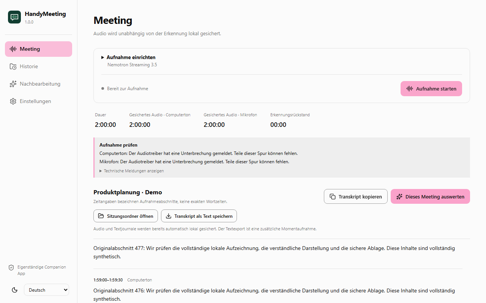
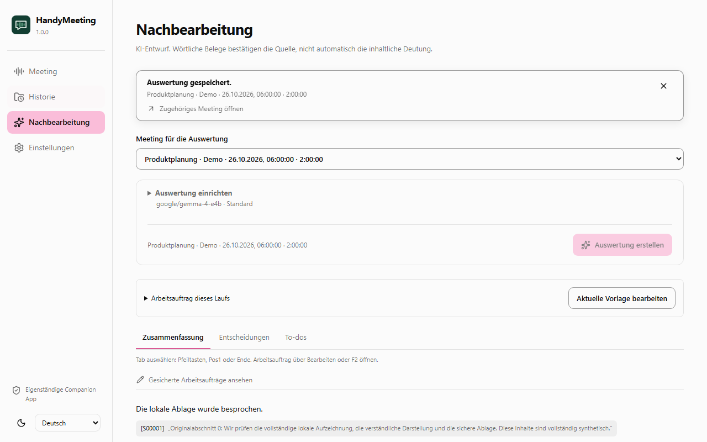
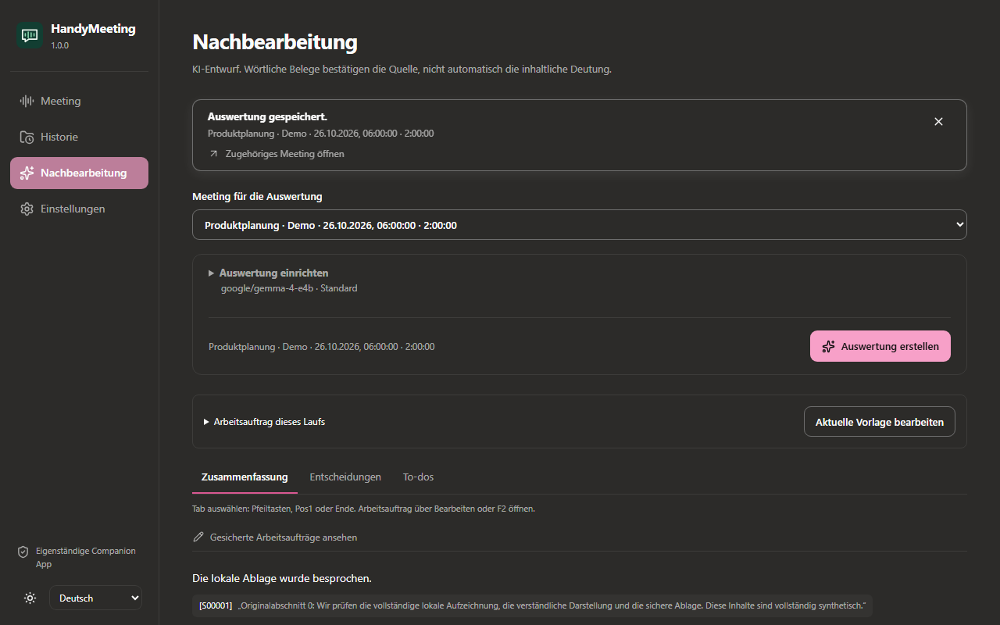

<h1 align="center">Meeting for Handy</h1>

<strong>Dein Meeting. Dein Computer. Dein Transkript.</strong>

[Downloads](https://github.com/Puma7/meeting-for-handy/releases) · [English](README.md) · [Veröffentlichen](docs/RELEASING.md) · [Feedback](https://github.com/Puma7/meeting-for-handy/issues)

Meeting for Handy ist eine eigenständige **Rust-/Tauri-Companion-App für [Handy](https://github.com/cjpais/Handy)**. Sie nimmt Computerton und auf Wunsch dein Mikrofon getrennt auf, transkribiert lokal während des Meetings und erstellt anschließend belegte Zusammenfassungen, Entscheidungen und To-dos. Audiodateien werden dafür nicht in die Cloud geschickt.

## Pakete für deinen Computer

**[Releases und passende Downloads öffnen](https://github.com/Puma7/meeting-for-handy/releases)**. Einen vollständigen Release öffnen und unter „Assets“ das passende Paket auswählen. Dort liegen die versionierten Dateien mit ihren Prüfsummen.

| System | Pakettyp | Voraussetzung |
| --- | --- | --- |
| Windows 10/11 · x64 | Setup-EXE · ZIP ohne Installation | WebView2 und Microsoft Visual C++ x64; kein .NET erforderlich |
| Ubuntu 22.04+ / Debian 12–13 · x64 | DEB | PulseAudio oder PipeWire-Pulse; Bibliotheken über den Paketmanager |
| Mac · Apple Silicon / M-Serie | Apple-Silicon-DMG | macOS 15+ und Aufnahmeberechtigungen |
| Mac · Intel | Intel-DMG | macOS 15+ und Aufnahmeberechtigungen |

**Patch-Stand:** 1.0.1 korrigiert den Fehler beim erstmaligen Erstellen des Windows-Installationsordners aus 1.0.0. Eine leere Release-Seite oder ein Tag allein bedeutet keinen bestandenen Build: Alle fünf Pakete und `RELEASE_MANIFEST.json` müssen vorhanden sein. Der vollständige Release 1.0.1 ist inzwischen mit allen 17 Dateien geprüft und veröffentlicht.

**Künftige Releases:** Ein zur Programmversion passender Versionstag startet automatisch die Windows-/Linux-/Mac-Buildmatrix. Nach bestandenen Prüfungen hängen alle fünf Pakete und Nachweise an einem Release-Entwurf. Den vollständig bestückten Entwurf veröffentlichen; auch ein direkt veröffentlichtes Release startet diesen Ablauf. [Release-Anleitung](docs/RELEASING.md).

**Noch offene Freigaben:** Echte Mac-/Linux-Geräteaufnahmen und ein vollständiger neuer Rust-Zweistundentest stehen aus. Mac-Pakete sind ad hoc signiert und nicht von Apple notarisiert; die Windows-Setup-Datei ist unsigniert. Schutzprüfungen des Betriebssystems können diese Pakete blockieren. Schutzfunktionen nicht abschalten, um einen Build auszuführen. Wichtige Meetings zunächst unabhängig zusätzlich sichern. [Nachweise und Grenzen](TEST_REPORT.md).

## Vom Gespräch zur überprüfbaren Arbeitsgrundlage

- **Währenddessen mitlesen:** getrennte Spuren, lokales Streaming, gesichertes Audio und Erkennungsrückstand sichtbar.
- **Alles an einem Ort:** Historie, Sitzungsdetails, Originaltranskript, versionierte Auswertungen und der direkte Weg zum Sitzungsordner.
- **Vollständige Textdateien:** beide Transkriptspuren als neue TXT-Momentaufnahme speichern; frühere Exporte bleiben erhalten.
- **Eigene Vorlagen:** Tabs für Zusammenfassung, Entscheidungen, To-dos und weitere Arbeitsaufträge hinzufügen, bearbeiten und anordnen.
- **Nachvollziehbare Ergebnisse:** vorhandene Originalstellen und wörtliche Zitate, unbekannte Zuständige und Termine bleiben unbekannt.
- **Sichtbarer Fortschritt:** bestätigte Teilaufgaben, Laufzeit, Abbruch und Wiederaufnahme; heller und dunkler Modus sowie Deutsch und Englisch.

*Echte App-Komponenten mit künstlichen Demo-Inhalten. Die dargestellten zwei Stunden sind eine Oberflächenprüfung und kein Geräte-Dauertest.*

Die Vorlage ist wiederverwendbar, eine gespeicherte Auswertung behält dagegen ihren eigenen Originalstand und ihre Arbeitsaufträge. **Alle Ergebnisse als Markdown kopieren** enthält sämtliche Ergebnis-Tabs, Belege und das zugehörige Originaltranskript. Technisch vorhandene Zitate beweisen noch keine richtige inhaltliche Deutung.

## Das erste Meeting

1. Handy installieren und dort ein kompatibles **Streaming-Sprachmodell** herunterladen. Meeting for Handy erkennt die Installation und liest deren Modellliste. Gewichte sind nicht im Download enthalten.
2. Das passende Paket installieren. Das Windows-ZIP vollständig entpacken und über die enthaltene Startdatei öffnen. Unter Linux das DEB mit dem Paketmanager installieren; auf dem Mac die App aus der passenden DMG in „Programme“ ziehen.
3. **Meeting → Aufnahme einrichten:** Namen, Modell und die von der Meeting-App verwendete Tonausgabe auswählen. Das Mikrofon nur bei Bedarf zusätzlich aktivieren. Auf Mac werden derzeit die Standardgeräte verwendet.
4. Kurz testen, ob beide gewünschten Seiten ankommen. Die gewählte Tonausgabe kann auch andere Programme und Benachrichtigungen enthalten.
5. Meeting beenden, Transkript kontrollieren und **Dieses Meeting auswerten** wählen. **Sitzungsordner öffnen** zeigt Audio, Journale und gespeicherte Fassungen direkt im Dateimanager.

Für die lokale Nachbearbeitung wird zusätzlich ein lokaler Textmodelldienst benötigt, beispielsweise LM Studio. Dort ein Textmodell laden und den lokalen Server starten. Die Standardadresse lautet `http://127.0.0.1:1234/v1/`. Meeting for Handy fragt dessen verfügbare Modellkennungen ab; das Modell wird ausdrücklich ausgewählt. Ein Sprachmodell für die Audioerkennung ersetzt kein Textmodell für Zusammenfassungen.

## Datenschutz und Wiederherstellung

Audio und Textjournale werden lokal gesichert, unabhängig von der Erkennung. Bestätigte Schreibpunkte wurden nach Prozessabbrüchen wiederhergestellt; ein unbestätigtes Endstück kann trotzdem fehlen. Das ist kein Stromausfall- oder Hardwaredefektnachweis. Vorhandene Aufnahmen und Auswertungsfassungen werden nicht automatisch gelöscht.

Die Nachbearbeitung beginnt lokal. **Cloud · nur Text** verlangt für jede Auswertung eine ausdrückliche Freigabe. Übertragen werden Text, Quellenkennungen und Arbeitsaufträge, keine Audiodateien oder lokalen Pfade. Es gibt keinen automatischen Cloud-Ersatz. Ein separat betriebener lokaler Dienst muss seinerseits lokal rechnen.

Schlüssel bleiben standardmäßig nur für die App-Sitzung im Speicher. Freiwillige dauerhafte Ablage nutzt Credential Manager, Keychain beziehungsweise Secret Service. Unlesbare Einträge werden erhalten; Klartext ist kein Ersatzweg. Dateien selbst liegen unverschlüsselt lokal. Eine zusätzlich eingerichtete Ordnersynchronisierung kann sie unabhängig von der App übertragen.

Der bestehende lokale Anwendungsdatenpfad `HandyMeeting/RustBeta` bleibt aus Kompatibilitätsgründen erhalten. Die Windows-Deinstallation entfernt nur ihre aufgeführten Programmdateien und löscht Sitzungsordner nicht rekursiv. Alte Prototypen bleiben erhalten.

Zwei Audiospuren sind keine Personenerkennung. Sprechernamen werden nur nach deiner ausdrücklichen Bestätigung zugeordnet. Die optionale nachträgliche Audiotrennung (Beta) und die Live-Sprecherabschnitte (experimentell) in 1.0.2 liefern neutrale Kennungen je Abschnitt, hängen von einem kompatiblen Modell ab und erkennen keine Personen. Exakte Wortzeiten und belastbare Wörter-pro-Person-Statistiken sind nicht implementiert. KI-Ergebnisse bleiben überprüfbare Entwürfe. Lokale Agenten erhalten nur nach sichtbarer Freigabe Zugriff auf ihre eigene neue Aufnahme; Mikrofonfreigabe ist getrennt. Die Schnittstelle ist kein MCP-Server.

## Im Handy-Ökosystem

Die Companion-Richtung entstand aus [Handy Discussion #1923](https://github.com/cjpais/Handy/discussions/1923). Meeting for Handy liest installierte Modelle und verwendet gepflegte transcribe.cpp-Bindings mit festgelegter nativer Laufzeit. Handy-Einstellungen, Schlüssel und Gewichte werden nicht geändert. Die Erkennung läuft in eigenen Prozessen; eine bereits geladene Handy-Modellinstanz wird nicht geteilt. Neue Modellformate können ein Laufzeitupdate erfordern.

Meeting for Handy ist **kein offizielles Handy-Produkt** und hat keine bestätigte Integrationsvereinbarung. [Vorschlag für eine unterstützte Companion-Schnittstelle](docs/HANDY_UPSTREAM_PROPOSAL.md).

## Mitwirken

[Rust-Build und Prüfungen](docs/RUST_BUILD.md) · [Release-Ablauf](docs/RELEASING.md) · [Geräteprüfplan](docs/NATIVE_VALIDATION.md) · [Agentenprotokoll](docs/RUST_AGENT_PROTOCOL.md) · [Lokale Dateien](docs/MEETING_FILES.md) · [Contributing](CONTRIBUTING.md) · [Prüfbericht](TEST_REPORT.md)

Paket- und Bibliotheksversionen sind gesperrt. GitHub prüft Quellstandbindung, Sicherung, Wiederaufnahme, Quellen, Oberflächenabläufe, native Schlüsselablage, verschobene Programmpakete sowie Windows-Installation und Datenerhalt bei der Deinstallation. Erfolgreiche Builds und echte Gerätenachweise werden getrennt ausgewiesen. Ältere C#-Downloads und ihre Anleitung bleiben über [BUILD_STATUS.md](BUILD_STATUS.md) und die früheren Release-Tags zugänglich.

MIT-Lizenz; Originalhinweise unter [THIRD_PARTY_NOTICES.txt](THIRD_PARTY_NOTICES.txt) und `licenses/`. Modelle, Aufnahmen, Einstellungen und Zugangsschlüssel gehören weder zum Quellpaket noch zu den Downloads.

## Folgeabschnitt 1.0.4 (unveröffentlicht)

Pause/Fortsetzen der Aufnahme und eine getrennte App-Mikrofonstummschaltung halten die Zeitachse mit ausdrücklich markierter Stille und erhaltenen Steuerungsereignissen. Vollständige Transkripte lassen sich als TXT, abgesichertes Markdown oder strukturiertes JSON mit Quellenkennungen und Abschnittszeiten speichern. Ausdrückliche Programm-/Importauswahlen verlangen einen nativen Dateidialog und eine Bestätigung je App-Start. Echte Unterbrechungs-, Langzeit-, Mac-/Linux-Geräte- und Signaturprüfungen bleiben eigene Freigabekriterien.

Der sichtbare Name lautet **Meeting for Handy**. Daten-/Schlüssel-/Bundle-Kennungen, interne Programmnamen und der Downloadpräfix `HandyMeeting-<Version>-...` bleiben für ältere Installationen und deren Updates erhalten. Frühere Programme und Verknüpfungen werden erhalten. Der neue Windows-Startmenüeintrag heißt **Meeting for Handy**; eine blockierende Skriptausführungsrichtlinie wird nicht abgeschwächt.
